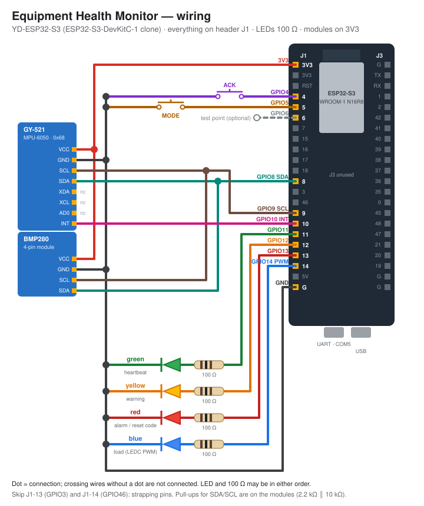

# Equipment Health Monitor

ESP32-S3 firmware (ESP-IDF v6.0.2, plain C) that watches another machine: vibration from an MPU-6050 (GY-521) at 1 kHz and temperature from a BMP280-class sensor (the module on the bench is a BME280, chip id 0x60), two operator buttons, four status LEDs, a crash-surviving black box, watchdog self-monitoring and deep sleep. A Beetroot Academy learning project; the spec is in [TASK.md](TASK.md) and the task list in [TASKS.md](TASKS.md).

## Wiring



Everything sits on header J1 of the YD-ESP32-S3 (ESP32-S3-DevKitC-1 clone). Pin budget and the reasons behind each pin: [docs/pins.md](docs/pins.md). Parts: [docs/bom.md](docs/bom.md).

| Signal | GPIO | J1 pin | Notes |
|---|---|---|---|
| BTN_ACK | 4 | 4 | to GND, internal pull-up, pressed = LOW, RTC-capable (deep-sleep wake) |
| BTN_MODE | 5 | 5 | same |
| DBG (optional) | 6 | 6 | scope test point |
| I2C SDA | 8 | 12 | both sensors, 400 kHz, pull-ups on the modules |
| I2C SCL | 9 | 15 | |
| MPU INT | 10 | 16 | MPU-6050 data-ready, active high |
| LED green / yellow / red | 11 / 12 / 13 | 17 / 18 / 19 | through 100 Ω to GND, active high |
| LED blue | 14 | 20 | through 100 Ω, LEDC PWM 5 kHz, 8 bit |
| 3V3 / GND | – | 1 / 22 | both sensor modules on 3V3 |

## Build and flash

```powershell
. C:\Espressif\tools\Microsoft.v6.0.2.PowerShell_profile.ps1
idf.py set-target esp32s3   # only if sdkconfig is missing
idf.py build
idf.py -p COM5 flash monitor
```

## Layout

- `main/`: thin `app_main`, `board_pins.h` (all pins), `app_config.h` (rates, windows).
- `components/board_hal/`: the only code that touches ESP-IDF drivers and system APIs.
- `components/mpu6050`, `bmp280`: sensor drivers on top of the HAL.
- `components/analysis`, `button_decoder`, `monitor_fsm`, `indicator`, `blackbox`, `bmp280_calc`: hardware-free logic, host-tested.
- `docs/adr/`: design decisions. `docs/log.md`: learning log with bench measurements.

## Status

See the task table in [TASKS.md](TASKS.md).
